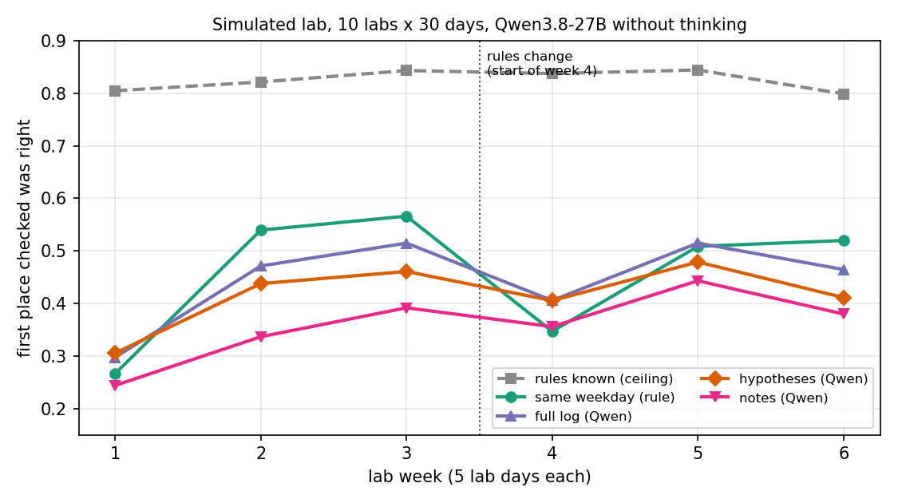

# Lab routine simulation: results (overnight 2026-10-17, 01:15-05:00)

Design, task choice and the predictions made before the run: `DESIGN.md`. Everything ran on cheetah with the local
Qwen3.8-27B (FP8 weights). No paid spend, and nothing was sent to the dog.

## The answer in four lines

1. **Writing hypotheses beat writing free notes** (first place checked right 41.7% vs 35.9%, +5.8 points, 2 SE 3.2;
   0.48 fewer looks per search, 2 SE 0.15). That is the only comparison the hypothesis memory won.
2. **It did not beat keeping the full log** (−2.9 points, 2 SE 2.6), **or the plain rule "where was it on the same
   weekday last time"** (−4.2 points, 2 SE 2.2). Last seen, most often, same weekday, the full log and the
   hypotheses all sit at 42-46% (notes 36%), against 83% for a method that knows the rules.
3. **Qwen never found a rule.** Graded on days 5-30, no Qwen memory stated the weekday, cue, Friday, out-of-lab,
   random or rotation rule in any lab. It only ever wrote "X is at Y" (correct only for the always-in-one-place prop).
   A rule change was said to be a change 3 times in 252 chances (graded memories on days 20-30, all Qwen variants).
4. **The cause is the induction step, not the record.** When the evidence was written with weekdays, the toy dog's
   hypothesis read "for: Wed, Mon, Wed, Mon (sofa); against: Thu, Tue (under_desk_2)", which is its rule, and the
   statement was still "toy_dog is at sofa". Thinking (4000 tokens) did not help, and made the hypothesis memory worse: see below.

## Numbers (10 labs x 30 lab days; 3 searches and 7 forecasts a day)

| method | first place right | looks to find (not found = 6) | found within 3 | real out days called out | in lab, not found, called out |
|---|---|---|---|---|---|
| rules known (ceiling, not a method) | 82.5% | 1.97 | 83% | 71% | 4% |
| same weekday (rule) | 45.8% | 2.92 | 67% | 46% | 17% |
| full log (Qwen) | 44.5% | 2.76 | 72% | 14% | 7% |
| most often (rule) | 42.9% | 2.92 | 67% | 38% | 38% |
| last seen (rule) | 42.1% | 2.92 | 69% | 38% | 37% |
| **hypotheses (Qwen)** | 41.7% | 3.09 | 63% | 8% | 12% |
| hypotheses, evidence with weekdays (Qwen) | 43.0% | 3.00 | 65% | 14% | 9% |
| notes (Qwen) | 35.9% | 3.57 | 50% | 1% | 4% |
| no memory (Qwen) | 6.0% | 4.99 | 19% | 14% | 12% |

Paired differences are over labs (each lab's mean, then the mean and 2 standard errors of the 10 differences).
Rerunning the hypotheses method on labs 0-3 moved first-look accuracy by 2.2 points and looks by 0.20, so
differences below that are not distinguishable from rerun noise.

By rule type (first place checked right, props in the lab):

| method | weekday | cue | fixed | friday | away | random | rotation |
|---|---|---|---|---|---|---|---|
| rules known (ceiling, not a method) | 89% | 94% | 94% | 93% | 89% | 30% | 91% |
| same weekday (rule) | 44% | 46% | 59% | 73% | 72% | 25% | 11% |
| full log (Qwen) | 21% | 48% | 77% | 61% | 75% | 31% | 8% |
| most often (rule) | 20% | 53% | 47% | 64% | 79% | 27% | 23% |
| last seen (rule) | 21% | 44% | 78% | 52% | 72% | 28% | 10% |
| **hypotheses (Qwen)** | 19% | 43% | 76% | 58% | 68% | 29% | 8% |
| hypotheses, evidence with weekdays (Qwen) | 22% | 45% | 79% | 57% | 66% | 29% | 11% |
| notes (Qwen) | 16% | 42% | 70% | 48% | 40% | 29% | 6% |
| no memory (Qwen) | 10% | 6% | 5% | 0% | 10% | 1% | 9% |

- Weekday and rotation props are where a rule pays most (ceiling 89-92%); every Qwen memory is at 6-22%, about the same as
  last seen (21% and 10%).
- "Same weekday" drops hardest at the change (week 4, 35%) because it keeps using the old weekdays, then recovers.
  The Qwen memories drop less, because they never used a pattern in the first place.
- Out of the lab: the Qwen memories almost never say a prop is out (notes 1%, hypotheses 8% of real out days), while
  the simple rules say it 38-46% of the time but also say it wrongly 17-38% of the time. On the out-of-lab
  probability itself (Brier score, lower is better) the Qwen memories do better (0.09-0.10) than last seen and most
  often (0.18) and same weekday (0.11), mostly because out days are rare and they rarely say out.

## What the memories look like

- **Notes** (median 5,900 characters, up to the 8,000 cap): bookkeeping of which places were checked and empty,
  "last known locations", and fragments of reasoning ("Wait, let's re-verify checked vs unchecked"). No patterns.
- **Hypotheses** (median 2,700 characters): one active hypothesis per object, "backpack is at sink_floor", rewritten
  to the newest place. By day 30, 7 of 10 labs had also set some aside (1-6 each), each again of the form "X is at Y". In lab 1 the cables box hypothesis cites "Day 20 and Day 15
  at under_desk_2", both Fridays, which is its rule; the forecast for Monday then puts under_desk_2 first.
- **With thinking**: set-aside is used heavily: all 4 labs hit the 16-hypothesis cap (9-10 set aside), so that cap
  was binding for this method only. Every statement is still "X is at Y"; the thinking asks "could there be a pattern?" in some calls and settles on "most likely where seen yesterday".

## Thinking (labs 0-3, 4000-token budget per call)

| method (labs 0-3) | first place right | looks |
|---|---|---|
| full log, thinking at forecast | 47.3% | 2.80 |
| hypotheses, no thinking (rerun) | 45.3% | 2.94 |
| notes, thinking at update | 38.5% | 3.38 |
| hypotheses, thinking at update | 37.7% | 3.30 |

Paired over labs 0-3: hypotheses with thinking vs without −5.4 points (2 SE 2.7); vs full log with thinking −9.6
(2 SE 1.5); notes with vs without thinking +1.8 (2 SE 6.5); full log with vs without thinking +0.8 (2 SE 3.8).
So thinking did not help any memory, and made the hypothesis memory worse. In the graded memories it found no rule
either (one notes memory wrote "bottle likely alternates bench_low/under_desk_1"; the grader marked it correct, but
it has no weekdays and the rule is Mon/Wed/Fri vs Tue/Thu, so I count it as partial). Every thinking call used its
full 4000 tokens, mostly on bookkeeping of which places were checked. Unbudgeted thinking took 11-28k tokens and
15-25 minutes a call, which is why the budget was added (first days kept in `runs_discarded/`).

## The predictions written before the run (DESIGN.md), against what happened

1. Same weekday the strongest simple method, close to Qwen on weekday, away, friday and fixed props: strongest, yes;
   but it beat every Qwen memory on weekday (44% vs 16-22%) and friday (73% vs 48-61%) props instead of matching them.
2. Hypotheses best on cue and rotation props: wrong; no Qwen memory got either.
3. After the change, last seen recovers fastest and the written memories cling to the old rule: wrong for the reason.
   The written memories held no rule to cling to; same weekday was the one that clung (35% in week 4).
4. Full log as good as notes: under-called; full log beat notes by 8.7 points (2 SE 2.6).
5. Out-of-lab calibration best for hypotheses, worst for last seen and most often: worst, yes (Brier 0.18); best was
   notes (0.088), then hypotheses with weekdays (0.092) and hypotheses (0.102).

## What this means for the real-lab experiment

- With Qwen3.8-27B as the memory writer, hypothesis maintenance in this form will look like last-seen in the lab
  too. The hidden-routine experiment would measure the model's induction, and the answer for this model is "none".
- Worth testing before the lab: a stronger model as the writer (the Oct 3 study: Opus noticed both illness spells
  and returns, Qwen's notes never recorded a change), or a prompt that asks for a per-object table by weekday and
  by day-in-sequence, which hands the model the rule families (a different and weaker claim).
- The simple "same weekday" rule is the baseline to beat; it is free and it is the strongest of the simple methods.

## Files

`world.py` (labs, rules, misses), `methods.py` (all methods and prompts), `llm.py`, `run.py`, `score.py`,
`grade.py` + `grade_summary.py` (memory grades, Qwen as grader; on three hand-written memories it graded
noticed / silent / stale change correctly; identical lines flip between correct and partial about 1 in 10),
`plot.py`, `progress.py`. Runs in `runs/<method>/seed_<k>.json` (every forecast, search, observation and the
memory after each day); grades in `grades/`; `results.json`, `score_output.txt`, `grade_output.txt`.
Experimenter sheets to run the same scripts in the real lab: `scripts/seed_<k>.md`.
