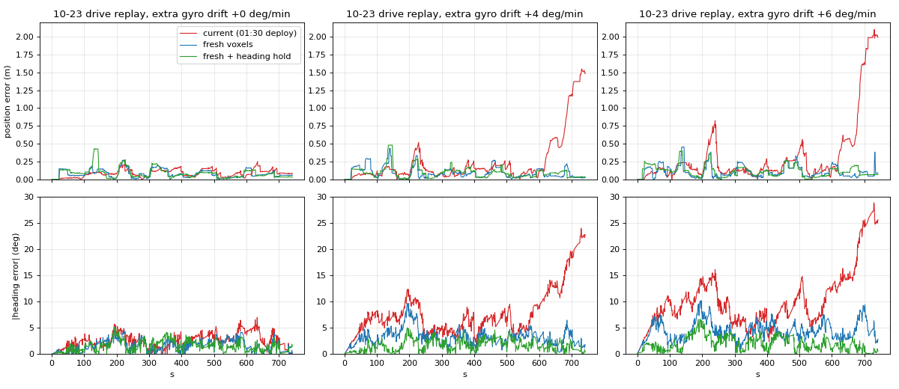

# Localization overnight study (2026-10-25, loc-research session on Z690)

All offline: no robot commands, nothing in `~/oliver` or the containers changed. Scripts and data in
`~/go2_overnight/loc/` (Z690). Prompted by Oliver's research doc (L1 localization, 2026 literature) and its
critique, and by the coordinator's review questions.

## TL;DR

1. **The drift tracker's real weakness is stale voxels, not sparse scans.** `/point_cloud2` (WebRTC
   `rt/utlidar/voxel_map_compressed`) is the dog's persistent voxel map: in a view, the median voxel was placed
   **72 s** earlier (95% are older than 5 s, 35% older than 2 min; voxels live a median 99 s). Each sits where the
   dog put it with the heading it had *then*, so `track()` fits an average of past headings. On real data
   (no injection), voxels 10-90 s old need a rotation that follows the gyro drift accumulated since they were
   placed (correlation 0.4, slope 0.8-0.9).
2. **Gyro bias is the dominant error source, and it is not constant.** While the dog stands still, odom yaw
   drifts a median **+1.15 deg/min** (pose logs 10-23..25, 95 live still periods, 238 min); 10-23 median +0.9,
   10-24 median +2.5, single periods from -4 to +6 deg/min. The 10-23 mapping drive's fitted model: 1.75 deg/min
   plus 0.6% of angle turned.
3. **The current tracker breaks at drift rates 10-24 actually had.** Replaying the 10-23 drive with extra
   simulated drift: at +4 and +6 deg/min it ends **1.4-2.0 m and 21-25 deg off**.
4. **A ~60-line patch fixes it in replay:**
   - Fresh voxels: `track()` uses only voxels that first appeared in the last 20 s.
   - Heading hold: while the dog stands still and isn't turning, odom yaw change is cancelled in T; while walking,
     the last measured bias is cancelled.

   With both, median heading error is 1.4-1.9 deg and position 0.07-0.10 m at every drift level, max 0.48 m. CPU
   per view goes from 10 to 7 ms.
5. **The lost flag (`_judge_lost`) fires 57-71 s after the error passes 0.5 m** and misses shorter episodes. Track
   fit alone separates good from bad poses poorly (good p10 0.73-0.77, bad median 0.65-0.69).

## Data

| source | what | used for |
|---|---|---|
| bag 10-23 14:31 (12.4 min, mapping drive) | 1688 clouds (127 M points), odom 24 Hz, IMU 27 Hz, camera | replay, mechanism, markers |
| bag 10-24 17:06 (42 s, 2.4 m walked) | 51 clouds | independent-day check (weak) |
| bags 10-14 / 10-15 | empty (36 KB) | — |
| pose logs 10-23..25 (5 Hz) | odom, map pose, T | gyro bias while still |
| `lab_straightened.info.json` | heading-error curve delta(t) of the 10-23 drive | reference trajectory |

Extracted to `~/oliver/go2_recordings/extract_*/` (numpy + jpg; robot data, not in git).

**Reference ("truth") and what the error means:** the go2_straighten trajectory of the 10-23 drive. Its heading
comes from the Manhattan angle of freshly placed walls (independent of the tracker, good to ~1-3 deg); its
positions are odom increments rotated by that heading, so they inherit odom's distance scale. The live map
(`lab.grid.npz` = `lab_straightened`) was built from these poses. "Error" therefore means "distance from where the
saved map says the dog was", not absolute truth, and the 10-23 drive is the easy case for any tracker.

## 1. Gyro bias while still (pose logs)

`poselog_bias.py`. Still means moved < 1 cm in 2 s and the odom was live (yaw changes at least twice in the chunk;
1738 min of frozen odom while the dog was off were excluded). Chunks up to 5 min.

| | chunks | minutes | median drift | IQR |
|---|---|---|---|---|
| all | 95 | 238 | +1.15 deg/min | 0.32..2.22 (p10 -0.11, p90 3.82) |
| 10-23 | 66 | 175 | +0.87 | |
| 10-24 | 29 | 64 | +2.51 | |

Predicting a chunk's rate from the previous still chunk cuts the median error from 1.29 to 0.79 deg/min, and a
constant 1.15 gives 0.95. The bias wanders, so it must be measured online. In the 10-23 bag, the odom yaw rate
while still matches the raw IMU gyro z mean (e.g. +4.6 vs +5.3 deg/min): the dog's odom integrates an uncorrected
gyro bias.

## 2. Is `/point_cloud2` a per-scan cloud or an accumulated map? (`mechanism.py`, real data)

| | |
|---|---|
| voxel age within a view, p10/50/75/90/99 | 10.6 / 72 / 177 / 348 / 703 s |
| share older than 5 s / 30 s / 120 s | 95% / 75% / 35% |
| voxel lifetime p50/75/90 | 99 / 232 / 584 s |
| points within 1.5 m of the dog: median age | 60 s |

It is the dog's accumulated map. Age here is time since the voxel key first appeared: a wall re-observed in
the same cell keeps its old age, so ages are upper bounds on staleness.

**Heading of fresh vs stale voxels.** Best rotation (about the dog) that puts each age group onto the map at
the reference pose, against the reference drift accumulated since the group's median birth:

| group | n | median abs fitted rotation | median expected | corr | slope |
|---|---|---|---|---|---|
| fresh (<= 3 s) | 242 | 2.0 deg | 0.0 | 0.07 | — (noise) |
| 10-30 s | 275 | 1.5 | 0.6 | 0.38 | 0.89 |
| 30-90 s | 269 | 2.0 | 1.7 | 0.41 | 0.77 |
| > 90 s | 245 | 3.5 | 6.0 | -0.11 | — |

The mechanism holds for 10-90 s voxels. The oldest ones don't follow the model, likely mixtures and far
remnants. Fresh 3 s views carry ~2 deg of rotation noise of their own (few, one-sided points), which is why a
20-30 s window works better than 3 s.

## 3. Replay harness (`replay.py`)

- Loads a copy of the deployed `go2_mapper.py` (coordinator's 01:30 version) with a copy of `lab.grid.npz`.
- Feeds the clouds as `go2_dashboard.on_cloud` does: 2 Hz, 8 m box, floor = 20th percentile, no views while
  turning faster than 0.15 rad/s.
- Calls `pose()` at the console's 5 Hz tick on a simulated clock.
- Mapping off; starts from the reference line-up.

**Stress test (extra gyro drift).** Odom heading gets an extra k deg/min. Every voxel is moved as the dog would
have placed it at its birth time, so stale voxels smear like real ones. The coordinator rightly flagged that
this builds the stale-voxel mechanism into the test; section 2 is the real-data evidence that it exists.

| mapper | extra drift | pos err med / p90 / max (m) | heading med / p90 (deg) | last minute | ms per view |
|---|---|---|---|---|---|
| no tracking | 0 | 0.55 / 1.18 / 1.71 | 10.6 / 23.0 | 1.09 m, 25 deg | — |
| current | 0 | 0.08 / 0.16 / 0.25 | 2.5 / 4.5 | 0.09 m, 1.9 | 9 |
| fresh | 0 | 0.06 / 0.16 / 0.28 | 1.5 / 3.0 | 0.06 m, 0.5 | 7 |
| fresh + hold | 0 | 0.07 / 0.17 / 0.43 | 1.4 / 3.0 | 0.04 m, 1.2 | 7 |
| current | +4 | 0.13 / 0.58 / **1.55** | 6.6 / 13.5 | **1.37 m, 20.7** | 10 |
| fresh | +4 | 0.07 / 0.19 / 0.44 | 3.1 / 5.0 | 0.03 m, 2.3 | 7 |
| fresh + hold | +4 | 0.08 / 0.15 / 0.48 | 1.5 / 3.2 | 0.04 m, 0.8 | 7 |
| current | +6 | 0.15 / 0.72 / **2.10** | 9.1 / 16.1 | **1.99 m, 25.3** | 10 |
| fresh | +6 | 0.08 / 0.23 / 0.46 | 4.2 / 6.9 | 0.09 m, 4.8 | 7 |
| fresh + hold | +6 | 0.10 / 0.22 / 0.40 | 1.9 / 3.8 | 0.07 m, 0.5 | 7 |

Other checks:
- **Fresh window:** 1.5-10 s all give plateaus of 0.3-0.5 m at the same moments (one-sided views slide along a
  wall). 20-60 s removes them; 20 s keeps the most drift robustness.
- **Fallback to all voxels when fresh is thin:** no measurable effect. Only 1% of 20 s views have < 200 fresh
  wall cells, 8% < 400. It's kept in the patch as a guard.
- **Wrong starting placement** (0.3-0.5 m, 5-10 deg): current and patched recover alike, within 25-60 s of
  driving.
- **10-24 bag (different day from the map; 42 s, 2.4 m walked):** current made 1 correction and stayed with the
  live console's pose. Fresh made 8 and ended 0.27 m and 4 deg away. There's no reference, so it's
  **unresolved** which is right. The console had run for two hours with high drift before this bag, so stale
  voxels could be what pins the current tracker. Not evidence for or against.
- **Furniture over-fitting:** not tested beyond the 10-24 bag. No lidar was recorded on any other day after the
  map was made.

## 4. Lost flag

| replay | error first > 0.5 m | lost flagged | delay |
|---|---|---|---|
| current, +4 | 633-647 s | 704 s | 57-71 s |
| current, +6 | 225 s (recovers by 255 s) | 708 s | (episode missed) |

Fit around those moments falls slowly (0.82 -> 0.74 -> 0.64 over a minute). Good poses (< 0.2 m) have fit p10
0.73-0.77; bad poses (> 0.5 m) have median 0.65-0.69, p90 0.73-0.77. A fixed threshold can't be both fast and
quiet. Suggestions, not yet tested:
- fit relative to the run's own recent median, e.g. a drop of 0.08 sustained for 10 s;
- disagreement between fresh-only and all-voxel best corrections;
- a gated marker sighting that disagrees by > 0.5 m (see the marker report).

With the patch, the replays never reach 0.5 m, so the flag did not fire (1% at +6).

## Limitations

- One real drive with lidar, and the map was built from it. Stress tests add drift synthetically. Furniture
  change isn't tested.
- The heading hold's main benefit is long standing periods (agents thinking). The 10-23 drive has few, so the
  replay understates it. The bias numbers from the pose logs are the evidence there.
- The heading hold assumes "barely moved and turned < 0.5 deg in 2 s" means still. A slow real rotation under
  15 deg/min (0.25 deg/s) while standing would be cancelled; agent turns are much faster.

## Deploy proposal (to the coordinator; not deployed)

`fresh_hold_patch.diff` (117 lines incl. comments) against the 01:30 `go2_mapper.py`; `fresh_patch.diff` is the
fresh-only part (63 lines). Switches: `TRACK_FRESH_S = 0` and `HOLD = False` restore today's behaviour. Suggested
order: fresh first, as it changes only what `track()` sees; then the hold. On the first live session, watch
`loc.track` and the map pose against markers.

## Files (`~/go2_overnight/loc/`)

`replay.py` (harness), `mechanism.py`, `poselog_bias.py`, `go2_mapper_fresh.py`, `go2_mapper_fresh_hold.py`,
`fresh_patch.diff`, `fresh_hold_patch.diff`, `runs/*.npy` (per-run logs), `replay_*.png`.
